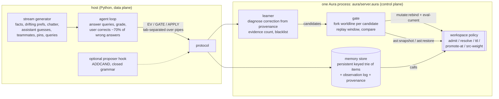

# aura-memory

**Aura-managed agent memory.** The store is white-box: you can list, query, edit, delete and pin facts, and every change carries provenance. That much is what PilotDeck 2.0-style white-box memory already gives you. aura-memory adds that the **memory-management policy is itself mutable code** in the Aura workspace. The policy decides what to admit, what to forget, what to promote to long-term, how to resolve conflicts and how to rank retrieval.

A learner reads the store's own provenance whenever a user correction arrives. It proposes a policy mutation (`mutate:rebind` + `eval-current`) and trials each candidate in its own forked worldline against a replay window. It keeps the candidate only if it beats the current policy, and otherwise rolls back with `ast:snapshot` / `ast:restore`. Every policy version is logged.

Everything runs offline and is reproducible from seeds. No LLM key is needed. There is an optional proposer hook, described below, that none of the numbers here use.

> Status: MVP. The stream is synthetic, the memory has 4 categories and one key per fact, and the policy grammar is small and closed. Read the caveats before quoting numbers.

## Why Aura for memory

| capability | PilotDeck-style white-box memory | aura-memory (this repo) |
|---|---|---|
| view / edit / delete / pin a fact | yes, at panel level | yes: `LIST` / `GET` / `EDIT` / `DELETE` / `PIN` protocol ops, each recorded with actor + policy version |
| *why* is a fact (not) in memory | partly | every offered write is logged with its outcome (`added`, `rejected`, `lost-conflict`, `lost-pinned`, `replaced`, `decayed`, …) |
| the management policy itself | fixed engine rules (plus Dream-style consolidation) | Aura workspace defines (`admit`, `resolve`, `ttl`, `promote-at`, `src-weight`) the agent rewrites at runtime |
| versioning / rollback of policy | some | `ast:snapshot` before every trial and `ast:restore` on rejection. Tests check the source is byte-identical after rollback |
| trying a policy change safely | n/a | each candidate runs in a forked worldline (an O(1) checkpoint of the persistent store) on a replay window. KEEP only if it is strictly better |
| audit trail | good | provenance per item, per offered write and per policy version (scores of base vs every candidate, verdict, ms) |
| maturity, UI, real users | a shipped product | **a research MVP**: synthetic stream, no UI, no embedding retrieval, single process |

Honest framing: PilotDeck solves the product problem (users can see and fix what the assistant remembers). aura-memory is an experiment on one narrower question. Can the rules that decide what gets remembered improve themselves safely from the same correction signal, with an audit trail and rollback? Nothing here says aura-memory is a better product.

## Architecture



* **Store:** items are `(id key val cat src ts last hits tier pinned policy-version by)`. They are indexed by key in a persistent, copy-on-write trie (8-ary, depth 4, 4,096 buckets, built from plain Aura lists). A write path-copies 4 nodes and one bucket and never mutates an existing store value, so a checkpoint is still just the value and forking a worldline for a trial stays O(1). Writes and queries cost O(bucket) instead of O(store) (see [Store scaling](#store-scaling)). The store value also carries a per-category index (counts, a lazily built expiry queue and a never-retrieved-items counter). That index keeps forgetting, the size check and STATS off O(store) (see [Learning at scale](#learning-at-scale)). The store lives in the control-plane process as Aura data. It is not one workspace define per fact, because per-fact `mutate:rebind` would be far too slow (see the latency section).
* **Policy:** [`aura/policy_seed.aura`](aura/policy_seed.aura) is a conservative, readable seed. Only the user is admitted. Preferences and facts are `keep-first`, so nothing is silently overwritten and an explicit correction is needed. Nothing is forgotten. Promotion happens after 2 hits. The learner keeps rule tables and compiles them into flat `cond` lambdas for `mutate:rebind`.
* **Diagnosis:** on a user correction (key, true value), the learner searches the observation log for that value. It is either never seen, rejected by `admit` (from which source), lost to `keep-first`, decayed by `ttl`, or overwritten by a lower-quality source. That yields 1–2 candidate mutations. For example, `lost-conflict` yields `resolve pref latest` and `resolve pref keep-both`. A separate check proposes `ttl` for a category when it holds 12 or more never-retrieved, untouched items (size pressure). A candidate needs at least 2 pieces of evidence. A rejected candidate is blacklisted until its evidence doubles. No-op candidates are dropped.
* **Gate:** the window starts from the newest checkpoint at least 100 events back. The gate replays it once for the current policy and once per candidate, each in its own worldline. User corrections are labels, not inputs: replay skips them, so a policy must keep memory right on its own. A query's label is the correction value if the user corrected it, otherwise the live answer (implicit acceptance). KEEP requires more labelled queries correct, or the same number with at least 10% less memory. Otherwise the gate calls `ast:restore`.

## Primitive mapping

| memory operation | Aura primitive(s) | where |
|---|---|---|
| load the seed policy | `set-code` + `eval-current` + `ast:snapshot "seed"` | `load-policy` |
| a policy decision (admit this write? which value wins?) | call of a workspace define (memoised per policy version) | `p-admit`, `p-resolve`, … |
| inspect the policy | `current-source :workspace`, `(query :find name)` | `POLICY`, `FIND` |
| propose / try a policy change | `ast:snapshot`, then `mutate:rebind name body why`, then `eval-current` | `apply-cand!`, `gate!` |
| reject a trial | `ast:restore snap` + `eval-current` (+ restore rule tables) | `gate!` |
| keep | `mutate:rebind` + `eval-current`, version++, log entry | `gate!` / `apply-ungated!` |
| fork a worldline | persistent store list captured every 20 events (no copy) | `*ckpts*`, `replay` |
| white-box fact ops | `LIST` / `GET` / `EDIT` / `DELETE` / `PIN` / `UNPIN` over the store, each appended to provenance | `handle` |

## Run it

```bash
export AURA_BIN=~/aura/build-rel/aura      # Aura build-rel binary (tested: main e50951bff; c6a18e8a5 and 9f82bede1 break the gate, aura#4611, and corrupt the heap, aura#4625)
scripts/test.sh --docker                   # unit tests (control-plane tests need AURA_BIN)
scripts/bench.sh --docker                  # acceptance + in-process latency + 4-mode bench, prints tables
scripts/bench.sh --docker --noise 1.0 --modes adaptive adaptive-nogate   # noise ablation
scripts/in-docker.sh 'python3 -m aura_memory inspect --seed 0 --upto 400' # white-box tour
scripts/in-docker.sh 'python3 -m aura_memory run --mode adaptive --seed 3' # every verdict of one stream
scripts/in-docker.sh 'python3 scripts/scale.py --n 20000 --block 4000 --steady 8000 --out results/scale/index-20k.json'  # store scaling
AURA_MEMORY_MEM=8g scripts/in-docker.sh 'python3 scripts/scale_learn.py --n 20000 --events 600'  # learning on a big store (--old-every 0: the ttl wins)
```

`--docker` runs inside `ghcr.io/cybrid-systems/dev:v1.0.9` with `--memory=4g`, `AURA_SANDBOX=off`, `AURA_PIPELINE_STRICT=0`.

## The stream

`aura_memory/stream.py` is seeded and has 600 events by default, with the distribution shift at event 300.

* **Phase A:** the user states 5 stable facts and 6 preferences. A preference changes in 20% of the times the user states it. Chatter (12%) attributes other people's preferences and facts to the user, or talks about unrelated people. The assistant guesses preferences, right half the time. There are short-lived episodic notes, pins, and queries (30%) whose correct answer is the *current* truth.
* **Phase B (shift):** preferences drift 3× faster (60%), and a new `project` category appears. Its updates arrive from **teammates**, a source the seed policy has never admitted. Episodic volume doubles, which adds memory-size pressure.
* **User model:** after a wrong answer, the user corrects it with probability 0.7. Each correction counts as one *user correction needed*. A correction is a white-box edit: it replaces the key's values, or appends under `keep-both`.

## Results

These are 5 seeds (0–4) of 600 events each, from `results/bench.md`, on Aura main `e50951bff` (re-pinned 2026-10-18). Accuracy and every learner decision are identical to the first run on `c8ad457c9`; only latency changed. Accuracy is the share of queries answered with the current truth. A stale answer is a value that used to be true.

| mode | accuracy (mean, min–max) | window 1 / 2 / 3 | stale-answer rate | user corrections | memory size (final / mean) | proposals | KEEP / ROLLBACK |
|---|---|---|---|---|---|---|---|
| append-only (RAG-style) | 78.0% (72.6%–83.1%) | 80.4% / 81.3% / 71.3% | 11.2% | 33.4 | 215 / 110 | – | – |
| fixed white-box (PilotDeck-like) | 80.0% (74.1%–84.0%) | 90.8% / 81.0% / 65.9% | 17.3% | 29.0 | 96 / 45 | – | – |
| **adaptive (Aura, gated)** | **95.9%** (93.5%–97.5%) | 94.0% / 94.9% / 99.3% | **2.6%** | **6.0** | **32** / 26 | 3.4 | 3.0 / 0.4 |
| adaptive, no gate | 95.2% (90.9%–97.5%) | 93.8% / 94.2% / 97.9% | 3.1% | 6.6 | 32 / 26 | 3.6 | 3.6 / 0.0 |

Accuracy by category:

| mode | pref | fact | project | episodic |
|---|---|---|---|---|
| append-only | 74.3% | 77.9% | 71.5% | 100.0% |
| fixed white-box | 74.1% | 100.0% | 39.6% | 100.0% |
| adaptive | 95.7% | 100.0% | 81.7% | 100.0% |
| adaptive, no gate | 94.2% | 100.0% | 81.7% | 100.0% |

Main findings:

* **What the learner found on all 5 seeds:** the same three mutations:
  - `resolve pref latest`, from stale-preference corrections, kept around event 70–200;
  - `ttl episodic 60`, from size pressure, kept around event 250–350. The gate picked 60 over 120 because both were equally accurate and 60 kept less memory;
  - `admit project teammate`, after the shift, kept around event 325–440.

  [`results/example-adaptive-seed0/`](results/example-adaptive-seed0) has the version log, base vs candidate scores and the final policy source.
* **Each baseline fails where you'd expect.**
  - Append-only remembers chatter and wrong assistant guesses, so facts fall to 77.9%. It also grows to 215 items.
  - The fixed policy is perfect on facts, but goes stale on drifting preferences (17% stale answers) and never learns to trust teammates (project 39.6%). The user fixes things by hand about 29 times per stream, against 6 for adaptive.
* **The gate's value depends on how good the diagnoses are.**
  - With clean diagnoses, the learner proposed `admit pref assistant` on 2 of 5 seeds: a correct assistant guess was logged as rejected. Both times the gate rolled it back. No-gate kept it and lost 1–2.6 points on those seeds.
  - With 30% of diagnoses mis-attributed (`results/noise30.md`), the results barely change, because the evidence threshold filters out most noise. Adaptive scored 95.2% and no-gate 94.5%.
  - The **noise ablation with every diagnosis mis-attributed** (`--noise 1.0`, `results/noise100.md`) is the clear case:

| noise 1.0 | accuracy | proposals | KEEP / ROLLBACK | episodic acc |
|---|---|---|---|---|
| adaptive (gated) | 80.0% (= fixed baseline) | 8.2 | 1.0 / 7.2 | 100% |
| adaptive, no gate | 78.0% | 12.0 | 12.0 / 0.0 | 81.8% |

With every diagnosis wrong, the gate rejected every harmful candidate. It kept only the size-driven `ttl episodic 60`, and accuracy stayed at the fixed baseline. Without the gate the policy oscillated, for example toggling `admit episodic user` back and forth 8 times, and fell below the baseline.

### Latency

Measured while the bench ran 3 streams in parallel on a shared box, so absolute numbers are inflated. See [`results/latency.txt`](results/latency.txt). Right column: the first run on `c8ad457c9`.

**In-process**, inside one Aura process:

| step | µs (`e50951bff`) | was |
|---|---|---|
| workspace policy call | 5.8 | 79 |
| `mutate:rebind` + `eval-current` | 570 | 2,950 |
| `ast:snapshot` | 240 | 4,180 |
| `ast:restore` + `eval-current` | 430 | 6,470 |
| trial cycle (snapshot → rebind → eval → call → restore → eval) | 1,690 | 14,620 |

**Host round trip over pipes:**

| mode | query p50 / p99 | write p50 | policy mutation p50 / max | query p50 was |
|---|---|---|---|---|
| append-only | 1.9 ms / 9.6 ms | 1.1 ms | – | 56 ms |
| fixed | 1.1 ms / 4.0 ms | 0.7 ms | – | 24 ms |
| adaptive | 1.0 ms / 2.5 ms | 0.6 ms | GATE 108 ms / 165 ms (was 3.6 s / 5.7 s) | 20 ms |
| adaptive, no gate | 1.0 ms / 2.9 ms | 0.7 ms | APPLY 2 ms / 6 ms (was 13 / 16 ms) | 20 ms |

A 600-event stream now takes about 1 s of wall time per mode (was 12–39 s).

* **Queries got ~20× faster** because aura#4585 is fixed: host-program calls no longer slow down after the first `set-code`. The ablation (same fixed policy as plain program defines, no `set-code`) now differs by only ~20%: 1.27 ms vs 1.05 ms p50 per query, where it was 23 ms vs 3.7 ms. The store scan, ranking and provenance still run in the interpreted host program; the append-only store is larger and its periodic sweeps are O(n), hence its p99.
* **A gate now costs about 0.1 s** (it was 2.7–5.9 s). It still replays about 100 events per worldline (1 base + 1–2 candidates) in the host program; rebinding and restoring the policy is about 1 ms of that per candidate. Gates are rare (about 3–8 per 600 events), so this is fine for interactive use.

### Store scaling

[`scripts/scale.py`](scripts/scale.py) writes N distinct facts into one control-plane process. Learning is off and nothing expires, so the store grows to N items. Each write is followed by a query on a random existing key. `--steady M` then issues M more queries against the full store. Results are host round-trip p50s on `e50951bff`, in [`results/scale/`](results/scale/).

| items | write p50, list store | write p50, trie index | query p50, list store | query p50, trie index | RSS, trie index |
|---:|---:|---:|---:|---:|---:|
| 1,000 | 2.4 ms | 0.58 ms* | 5.1 ms | 0.87 ms* | 141 MB* |
| 4,000 | 12.2 ms | 0.58 ms | 30.0 ms | 0.87 ms | 141 MB |
| 8,000 | ~24 ms (extrapolated) | 0.63 ms | ~60 ms | 0.94 ms | 200 MB |
| 20,000 | ~60 ms (extrapolated) | 0.70 ms | ~150 ms | 1.03 ms | 337 MB |
| 20,000 + 8,000 queries | – | – | – | 1.07 ms | 349 MB |

\* first 4,000-item block. The list store took 151 s of wall time for 4,000 items, against 7.6 s with the index (48 s for 20,000).

* **The old store was O(n) per event.** Each query or write filtered and mapped every item, and every 10th event swept the whole store twice. At ~1.5–3 µs per interpreted element visit, that is 30 ms per query at 4,000 items (`results/scale/list-4k.json`, the released list store on the same pin).
* **The index is equivalent.** Replaying 5 full streams (adaptive with 0% and 30% noise, ungated, fixed, append-only) through the old and the new server gives byte-identical replies, every verdict and score included (`.scratch/eqv.py`, not committed). Gate latency at the default store size (~30 items) is unchanged.
* **Steady state:** RSS still grows ~1.5 KB per query on a fixed store. Part of that is the event and provenance log (by design). Part is Aura: strings are never reclaimed (aura#4608).
* **Aura shaped the design.** These issues were filed from here:
  * `(hash)` can't serve as the index: `hash-ref` misses are O(table size), 0.8 ms at 40k keys (aura#4612).
  * Vector nodes leaked ~7 KB per write: `vector->list` and `list->vector` results are never reclaimed (aura#4613), and the std `vector-copy` is an interpreted loop at ~560 µs per 64 slots (aura#4614).
  * Aura has no persistent map and no string hash, and std `hash-set` silently mutates (aura#4614).
  * So the trie is built from lists, and its key hash samples 5 characters (O(1)), because a full fold costs ~50 µs interpreted.
* **Interpreter overhead dominates what is left.** An empty named-let iteration costs ~2.4 µs on `e50951bff` and ~1.2 µs on `c6a18e8a5` (aura#4599).

### Learning at scale

[`scripts/scale_learn.py`](scripts/scale_learn.py) checks whether the learner, the gate and forgetting stay cheap once memory is big. It fills N never-retrieved episodic items with learning off, then turns learning on and runs 600 live events: writes and queries on 20 hot keys, plus an occasional read of an old item. Fifty events in, the size check sees N dead episodic items and proposes `ttl episodic 60` / `120`. The gate replays the window for each candidate. Both forget nearly the whole store, including old items that queries still read, so the verdict is ROLLBACK at every N. That is the right call, and the scores agree exactly between the old and new servers. Host round trips on `e50951bff`; raw output in `results/scale/learn-*.json` (`*-before` = the 4df7aca server; its 20,000 run is 100 events).

| N items | GATE (old → new) | size-check event, p99 (old → new) | STATS (old → new) | GET key (old → new) | EV p50 (old → new) |
|---:|---:|---:|---:|---:|---:|
| 1,000 | 2.9 s → **0.78 s** | 181 ms every 50 events → **3 ms** | 167 → 0.4 ms | 6 → 1.0 ms | 0.67 → 0.78 ms |
| 4,000 | 9.9 s → **2.0 s** | 418 ms every 50 events → **13 ms** | 357 → 1.3 ms | 29 → 1.3 ms | 0.88 → 1.12 ms |
| 20,000 | 32.0 s → **9.2 s** | 1,258 ms every 50 events → **4 ms** | 947 → 8 ms | 86 → 1.4 ms | 1.45 → 1.6 ms |

* **The old server paid O(store) in four places.**
  * The size check counted dead items with 4 full folds every 50 events: 22 µs per item visited, because each one is several interpreted closure calls and `list-ref`s.
  * Once a ttl existed, every 10th event ran a full-filter sweep, both live and inside every gate replay.
  * STATS counted categories with folds.
  * `diagnose` and GET scanned the whole observation and provenance logs.
  * The gate was also O(n²): the store kept a list of occupied buckets, and every dropped item that emptied a bucket filtered that list.
* **The new server keeps a per-category index in the store value,** so checkpoints and forked worldlines carry it for free.
  * A count per category makes STATS O(1).
  * A lazily built expiry queue holds (last, id, key) entries in `last` order, with lazy invalidation, so a sweep pops only what has expired. The queue is built from the survivors of the first sweep under a new ttl. Sweeps that drop more than 1/8 of the store rebuild the trie in one pass instead of path-copying per item.
  * A dead-item counter is advanced over a queue of never-retrieved items, so the size check is amortized O(1). The first check pays one O(n) pass: the 166 / 433 / 1,503 ms p99 in the first block.
  * The occupied-bucket list is gone; whole-store folds walk the trie.
  * Per-key indexes over the observation and provenance logs (mutable vectors, because the logs are live-only) make `diagnose` and GET O(that key's history).
  * `INDEX` reports every category's counters next to a full recompute, and the tests check that they always agree under random churn, pins, unpins and kept ttls.
* **Replies are byte-identical to the old server.** That covers the 5 agent streams (3,130 replies, with 191 decays and 10 gates), 3 seeds of a random white-box stress (pin / unpin / edit / delete / STATS / LIST / GET with ungated and gated ttls), and the gate scores above.
* **What it costs.**
  * Plain writes pay for the index and the eager log index. At 20,000 items with learning off (`scale.py`), write p50 is 0.97 ms vs 0.74 ms and query p50 1.00 ms vs 1.10 ms (`results/scale/index-20k-r4.json`).
  * With learning on, the never-retrieved queue adds a little more (EV p50 1.6 ms at 20,000).
  * LIST stays O(store), since the output is the store.
* **Aura shaped it, and these were filed from here:**
  * **aura#4474 (reopened).** Aura re-marks the whole live heap at least every 32,768 allocations: the #4474 trigger is live/32, capped at 32,768. Above ~1M live objects, every allocation costs O(live heap) again: 100 conses take 320 µs with an empty heap and 1,930 µs with 800k live 12-field lists. In aura-memory this showed up as O(1) bookkeeping that got 2–3× slower as the store grew. So the index allocates as little as possible: closure-free updates, a count-only cell update while a category is untracked, explicit change lists instead of bucket diffs, and lazily built queues.
  * **aura#4616 (new).** `(map f l1 l2)` silently ignores every list after the first: `f` gets one argument and the result is `()`s, `0`s or partial procedures. Field updates use native `map` with a position counter instead. That costs ~38 µs per 12-field item, against 95 µs for the interpreted copy loop. A retrieval hit's three field updates now take one pass (50 µs instead of 285 µs).
  * Interpreter overhead is still the floor (aura#4599): about 1 µs per primitive call, so a 12-field functional update costs tens of µs.

### Gate early stop and allocation-light expiry

The gate replays the window from a checkpoint once per candidate. At 20,000 items most of that time went into the first bulk-expiry sweep and into per-item logging, and both are allocation-bound. Aura's per-cons cost grows with the live heap above ~1M cells (aura#4474): on this machine an allocation loop costs 5.0 µs per iteration with 0.3M live cells and 10.9 µs with 3M, while an empty loop stays at 2.1 µs. So this round cut allocations, not algorithmic work:

* **Early stop.** A candidate's replay stops as soon as `correct + remaining labeled events < best so far`. A stopped score is reported as `{"pruned": true, "replayed": k}`, and the verdict is unchanged because the candidate couldn't have won. Candidates are scored one at a time against the running best. `AURA_MEMORY_GATE_PRUNE=0` turns it off.
* **Bulk expiry without per-item garbage.**
  * Category counts are tallied into vectors (no cons per dropped item).
  * The first sweep under a new ttl splits a category in one trie walk instead of `cat-items` plus two filters.
  * Gate replays and batched decays skip the newest-first sort of the dropped list.
* **Decay batches.** A live sweep that expires at least `AURA_MEMORY_DECAY_BATCH` items (default 256; 0 = off) logs one batch record instead of an observation, a provenance record and two index inserts per item. GET, `diagnose` and STATS rebuild the same per-key records in the same order from the batch.

20,000 items, 600 events, host round trips on `e50951bff` (`results/scale/r6/`; `before` = the 2ffc8ae server):

| run | GATE before → now | first expiry event before → now | verdict / scores |
|---|---:|---:|---|
| `--old-every 7` (old items still read: both ttl candidates lose) | 9.4 s → **4.2 s** (6.6 s with `GATE_PRUNE=0`) | 1.47 s → 1.32 s | ROLLBACK, both candidates stopped after 67 replayed events |
| `--old-every 0` (nothing old is read: the ttl wins) | 8.9 s → **4.3 s** | 19.4 s → **3.8 s** (the kept ttl expires 20,000 items live) | KEEP `ttl episodic 60`, scores identical |

* **Same answers.** With pruning off, final STATS, the GET probes (`e1`, `e2`, `e10000`, `e20000`, `h1`) and the gate scores are identical to the 2ffc8ae server. The 5 agent streams and 3 white-box stress seeds show 0 semantic diffs with pruning on (pruned scores masked), with batch threshold 256 and with batch threshold 1. Two new tests check batch vs per-item GET and prune on vs off verdicts.
* **The standard bench barely notices** (`results/scale/r6/bench-prune-{on,off}.md`). Accuracy is identical and gate p50 is 135 vs 133 ms. Only 2 of 88 candidate scores are stopped, because at 600 events the candidates usually tie or win.
* **What's left** is ~2 s per candidate at 20,000 items: the checkpoint's store walk and the trial ttl's first sweep, which are still O(store) interpreted work at about 1 µs per primitive (aura#4599) plus the heap-size allocation tax (aura#4474).
* **aura#4625 (new, filed from here).** The first version of the one-pass split accumulated with `set!` on two captured `let` locals. On `c6a18e8a5` and `9f82bede1` that left a self-referential cons in the global provenance index, so GET lost a key's provenance and printing the key segfaulted. The split now threads an `(expired . kept)` pair through the fold, with the same replies and the same speed. `acceptance/4625` freezes the failing server with the 102-request trace that triggers it.

### Held-out gate

The gate used to judge a candidate only on the evidence window, which is the same window that produced the candidate. With `AURA_MEMORY_HOLDOUT=K` (default 0 = off), a candidate that beats the best score on the evidence window also gets a held-out replay over the K windows before it. It is vetoed if it answers fewer held-out queries correctly than the current policy does.

* **How it works.** Checkpoints are kept far enough back to cover the extra windows: `*ck-keep*` = max(12, 2 + window·(K+1)/ck-every). Windows with no labeled query are skipped and don't count toward K. The base policy's held-out score is computed lazily, once per gate, and stored in a vector cell rather than with `set!` (aura#4625). STATS/GATE replies gain a `"heldout"` object: `{correct, base, labeled, veto, windows, ms}`.
* **Overfit test** (`scripts/holdout_cost.py`, new test `HoldoutGateTest`). A short burst of queries that are never repeated makes `ttl episodic 5` look best on the evidence window. With K=0 the gate KEEPs it. With K≥1 it is vetoed (held-out 86 → 83 correct at K=1, 177 → 170 at K=2) and `ttl episodic 60` is kept instead.
* **Standard bench: no change.** 5 seeds × noise {0, 0.3, 1.0} × K {0, 1, 2, 4} (`results/holdout/`) give identical results for every K: 95.9% / 95.2% / 80.0% adaptive accuracy, with the same KEEP/ROLLBACK counts. On this stream the candidates fix the post-shift regime and never change held-out answers, so the veto never fires. It is a guard, not an accuracy gain.
* **Cost.** Each held-out pass replays its windows once for the base policy and once per winning candidate:

| store | K=0 | K=1 | K=2 | K=4 |
|---|---:|---:|---:|---:|
| 2,000 items | 1.3 s | 2.1 s | 3.0 s | 4.0 s |
| 20,000 items | 7.2 s | 11.9 s | 16.0 s | 20.8 s |

  RSS stays at about 250 MB. In the 20k `scale_learn` runs (`results/scale/r8/`), K=2 costs almost nothing (4.37 → 4.46 s with `--old-every 0`), because only windows with labeled queries are replayed. An earlier version also replayed unlabeled windows and doubled the gate to 8.8 s.
* **Profile and the fix** (`current-time-ms` instrumentation; there is no perf or gdb in the image). At 20k with K=0, 6.2 s of the 6.85 s gate went to 17 store sweeps. Each first sweep under a trial ttl took ~1.9 s: 0.46 s for the split, **0.94 s for the per-item category tally** (`cx-drop-many`, a `cx-pos` + `list-ref` per dropped item, ~47 µs each) and 0.43 s for `t-keep`. `store-sweep` already has the expired items per category, so `cx-drop-groups` now takes those groups and uses a native `length`. Only tracked categories walk their items (`counted?`). Results are identical: same scores, sizes and verdicts in the overfit run, and the same gates, STATS, GET probes and size rows as the stored 20k `scale_learn` run. The gate gets faster: overfit run 6.80 → **4.94 s**, `scale_learn --old-every 0` 4.37 → **3.23 s** (`results/scale/r8b/`). `AURA_MEMORY_CX_GROUPS=0` restores the old tally. The later sweeps are small (~22–25 ms each), because `t-keep` walks all 4,096 trie buckets even when the store is tiny. That is the next cut.
* **Aura bugs found on the way** (all in `c6a18e8a5` and later, none on `e50951bff`). A micro-benchmark of the expiry tally gave wrong answers on current main. Shrinking it gave **aura#4629**: a list of 2,000 `(i "episodic")` pairs built in a tail loop ends up with 18 self-referential elements. This is probably the root of aura#4623/#4625/#4627. Also **aura#4628**: `member` compares pairs, vectors and floats by identity. aura-memory only uses `member` on strings, so it is unaffected.

### Recall regime: where the held-out gate pays off

The R8 bench never exercised the held-out gate, because no earlier regime ever returned. `AURA_MEMORY_RECALL=P` (bench `--recall P`, default off) makes every other block of P events a recall block: episodic queries become ~7× as frequent and ask about notes 30–150 events old. In the other blocks only notes ≤15 events old are read. So when the size check proposes `ttl episodic 60`, it ties on correctness in a normal block and wins on size, and only a held-out window that contains a recall block shows the loss.

5 seeds, 1,200 events, P = 100, on `e50951bff` (`results/recall/`):

| | accuracy | user corrections | episodic accuracy | final / mean size | KEEP / ROLLBACK | gate p50 |
|---|---:|---:|---:|---:|---:|---:|
| noise 0, K=0 | 96.6% | 9.6 | 95.0% | 79 / 52 | 4.4 / 0.4 | 160 ms |
| noise 0, K=1 | 97.6% | 7.2 | 98.8% | 120 / 66 | 3.0 / 1.4 | 241 ms |
| noise 0, **K=2** | **97.7%** | **6.8** | **99.1%** | 141 / 72 | 2.6 / 2.0 | 285 ms |
| noise 1.0, K=0 | 76.6% | 69.0 | 78.8% | 55 / 46 | 1.4 / 13.0 | 96 ms |
| noise 1.0, K=1 | 81.0% | 55.6 | 94.1% | 89 / 56 | 0.8 / 11.8 | 103 ms |
| noise 1.0, **K=2** | **82.0%** | **53.6** | **97.2%** | 135 / 68 | 0.4 / 12.2 | 102 ms |

Baselines on the same streams: fixed 82.7%, append-only 81.4%, adaptive without a gate 95.9% (noise 0) / 73.3% (noise 1.0).

* **The veto works as designed.** On seed 0 (noise 0), K=0 KEEPs `ttl episodic 60` at t=495. Recall queries then fail, and three corrections push the ttl to 120 and then 240. K≥1 vetoes the same pair of candidates at t=495, and the learner later keeps `ttl 120` at t=841.
* **Under full diagnosis noise, the K=0 learner falls below the fixed baseline** (76.6% vs 82.7%), because noisy diagnoses keep getting short ttls accepted. K=2 brings it back to 82.0% and raises episodic accuracy from 78.8% to 97.2%.
* **The cost** is a bigger store (final size 79 → 141, because fewer ttls win) and roughly 2× gate time on the clean stream. The standard bench (no recall) is unchanged for every K (see Held-out gate). Making K=2 the default is reasonable for workloads where old context comes back.
* **Small-store sweeps.** Bulk expiry now needs at least `AURA_MEMORY_BULK_MIN` (default 256) dropped items. Below that, items are dropped one by one instead of walking all 4,096 trie buckets. Results are identical: gates, STATS, GET probes and sizes in the 20k `scale_learn` run, and every bench table. It helps big stores: 20k `scale_learn` gate 3.23 → 3.03 s, overfit gate 4.94 → 4.60 s (K=0) and 10.8 s (K=2; 16.0 s in R8). On the 600–1,200-event benches the change is within noise.
* **Current Aura main can't run this.** On `39595edd4` the bench hangs. The current server's first GATE dies with `list-ref: index out of bounds` (6/6 runs; on `e50951bff` it answers `KEEP resolve pref latest`). The error reply never reaches the client, so the worker waits forever. That is aura#4611, which until now was only seen on the released server. `acceptance/4611-current` freezes the server and the 103-request trace.

## Caveats

* **The stream is synthetic and designed to stress the seed policy.** Preferences drift, a new trusted source appears, and episodic volume grows. The seed is deliberately conservative (`keep-first`, user-only), which is a defensible white-box default, not a straw man, but the learner only has to find a few rule flips. The "fixed white-box" baseline is my approximation of a PilotDeck-like fixed policy, not PilotDeck itself.
* **Retrieval is exact-key lookup.** There are no embeddings and no fuzzy matching. `src-weight` / rank is in the policy but the learner does not mutate it yet, and it only matters under `keep-both`.
* **The gate's labels are partly implicit.** A query the user didn't correct counts as answered right. That makes the gate conservative: a candidate that fixes an uncorrected wrong answer is scored as wrong. The gate also judges a candidate on the same window that produced its evidence, unless the held-out gate (`AURA_MEMORY_HOLDOUT=K`) is on.
* **The noise model is simple:** a mis-attributed diagnosis maps deterministically to one wrong fix. The 30% setting barely stresses the gate; the 100% setting is the real test.
* **The policy grammar is closed:** admit/resolve/ttl/promote on 4 known categories. The learner never writes free-form code. The optional proposer hook (`aura_memory/proposer.py`, enabled by `AURA_MEMORY_LLM_URL`) can only add candidates in the same grammar, and each is still trialled by the gate. No result above uses it.
* **The sandbox is off.** `AURA_SANDBOX=off` is still required. #4575 added a scoped Soft auto-grant (`aura soft`), but under it `mutate:rebind` is refused with `commit-not-ready` (**cybrid-systems/aura#4609**). Run only on trusted input, in a container with a memory cap; the scripts use `--memory=4g`.
* **Only 5 seeds.** The adaptive-vs-baselines gap holds on every seed. The gated-vs-ungated gap is small, except in the noise ablation.

## Known Aura issues

| issue | effect here | status on `e50951bff` | check |
|---|---|---|---|
| cybrid-systems/aura#4583 | repeated `mutate:rebind` blows up next to a self-recursive workspace define | fixed upstream. The policy stays flat `cond`s because the learner compiles it from rule tables, not because of the bug | `acceptance/4583` (PASS) |
| cybrid-systems/aura#4584 | a sibling that passes a procedure to `filter`/`map` makes a workspace call dispatch to the wrong define | fixed upstream; `filter`/`map` in the workspace is safe again | `acceptance/4584` (PASS) |
| cybrid-systems/aura#4585 | host-program calls are much slower after one `set-code` | fixed upstream: query p50 23 ms → 1.1 ms | `acceptance/4585` (PASS), `results/latency.txt` |
| cybrid-systems/aura#4586 (filed from here) | an error raised inside a `map`/`filter` callback is swallowed: `try` can't catch it, `map` returns `<unknown>`, `filter` keeps the element | fixed upstream. It had hidden a gate bug: candidates silently ran with the old policy | `acceptance/4586` (PASS) |
| cybrid-systems/aura#4609 (open) | under `aura soft`, `mutate:rebind` is guard-rejected (`commit-not-ready`), so the Soft auto-grant from #4575 can't be used | `AURA_SANDBOX=off` + container memory cap | – |
| cybrid-systems/aura#4611 (open, filed from here) | regression in `c6a18e8a5` (#4599): a `filter` predicate gets the wrong element (`=` on `(car i)` sees a pair). The released server's first GATE dies with `list-ref: index out of bounds`, and since R10 the current server's does too on a recall-stream trace (the bench hangs) | **pinned to `e50951bff`**, which is unaffected (`c6a18e8a5` and `9f82bede1` FAIL the check) | `acceptance/4611`, `acceptance/4611-current` (PASS on `e50951bff`, FAIL on `39595edd4`) |
| cybrid-systems/aura#4625 (open, filed from here) | regression in `c6a18e8a5`, still on `9f82bede1`: a fold whose callback `set!`s captured `let` locals leaves a self-referential cons in an unrelated global vector (provenance lost, printing segfaults) | the expiry split threads its accumulator through the fold; current tests pass on `9f82bede1` too | `acceptance/4625` (PASS on `e50951bff`) |
| cybrid-systems/aura#4629 (open, filed from here) | regression in `c6a18e8a5`, still on `39595edd4`: building a list of pairs with a tail loop leaves 18 of 2,000 elements self-referential. This is the store/index/replay build shape, and probably the root of #4623/#4625/#4627 | **pinned to `e50951bff`** | `acceptance/4629` (PASS on `e50951bff`, FAIL on `39595edd4`) |
| cybrid-systems/aura#4627 (open, filed from aura-harness) | regression in `c6a18e8a5`: `(equal? (list 1 2) x)` is `#f` on every 66th loop iteration (vectors: every 131st) | pinned; the server compares strings and numbers, which are unaffected | – |
| cybrid-systems/aura#4628 (open, filed from here) | `member` compares pairs, vectors and floats with `eq?`, although it is documented as `equal?` | `member` is only used on strings | – |
| cybrid-systems/aura#4612 (open, filed from here) | `hash-ref` scans every slot, so a miss is O(table size) | the store index doesn't use `(hash)`; the key hash is computed, not memoised | – |
| cybrid-systems/aura#4613 (open, filed from here) | `vector->list` / `list->vector` / `(hash)` garbage is never reclaimed | trie nodes are lists, not vectors | – |
| cybrid-systems/aura#4474 (reopened from here) | the reclaimer re-marks the whole live heap every ≤32,768 allocations, so allocation cost grows with the live heap above ~1M objects | the store index, bulk expiry and decay logging are allocation-light (see Learning at scale and the gate early stop section); still present on `9f82bede1` | – |
| cybrid-systems/aura#4616 (new, filed from here) | `(map f l1 l2)` silently ignores every list after the first | field updates use 1-list `map` with a position counter | – |
| cybrid-systems/aura#4614 (open, filed from here) | no persistent map; std `hash-set` mutates; `vector-copy` is interpreted; no string hash | hand-rolled list trie | – |

`python3 -m aura_memory acceptance` prints PASS/FAIL for each item against `$AURA_BIN`. `memory-cycle` is aura-memory's own snapshot → rebind → restore → byte-identical round trip, and must PASS.

## Layout

```
aura/server.aura          control plane: store, white-box ops, provenance, learner, gate (protocol at the top)
aura/policy_seed.aura     seed memory-management policy (fixed white-box baseline = this, learning off)
aura/policy_append.aura   append-only baseline policy
aura/closed_loop_bench.aura  in-process latency micro-benchmark
scripts/scale.py          store-size scaling (N facts + queries, optional steady phase)
scripts/scale_learn.py    learning at scale (big store + size check + gate + forgetting)
scripts/holdout_cost.py   held-out gate: overfit candidate vs K, gate time and RSS at N items
aura_memory/              host: stream.py, control.py, agent.py, bench.py, acceptance.py, proposer.py, __main__.py
acceptance/               Aura issue repros + memory-cycle (4611 / 4625: frozen server + request trace on stdin; 4629: 3-line list build)
results/                  committed bench / noise / latency / acceptance outputs + one example version log
tests/                    unit tests (stream invariants; white-box ops, provenance, KEEP/ROLLBACK against a real Aura)
```

## Next steps

* The gate now stops losing candidates early and allocates little, but a trial still costs ~2 s per candidate at 20,000 items (the checkpoint's store walk plus the trial ttl's first sweep). Next: gate on a sampled window store, so a trial doesn't touch every item. Allocation cost rising with heap size (aura#4474) and interpreter overhead (aura#4599) are the Aura-side floors.
* Move to a newer Aura main once aura#4629 (list corruption), #4611, #4625 and #4627 are fixed. On `39595edd4` (latest checked) `acceptance/4611`, `4625` and `4629` still FAIL (`results/acceptance-39595edd4.txt`).
* Switch from `AURA_SANDBOX=off` to `aura soft` once aura#4609 is fixed.
* Make the held-out gate cheaper by replaying all candidates in one pass over the held-out windows, then consider turning it on by default. Try K=2 as the default and sample held-out windows from further back than the last K.
* Let the learner mutate `src-weight` / ranking, and add fuzzy (embedding) retrieval to the data plane.
* Run more seeds, sweep the noise from 0.3 to 1.0, and try a real conversation log instead of the synthetic stream.

## License

Apache-2.0. See [LICENSE](LICENSE).
