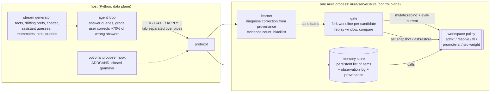

# aura-memory

**Aura-managed agent memory.** The store is white-box: you can list, query, edit, delete and pin facts, and every change carries provenance. That much is what PilotDeck 2.0-style white-box memory already gives you. aura-memory adds that the **memory-management policy is itself mutable code** in the Aura workspace. The policy decides what to admit, what to forget, what to promote to long-term, how to resolve conflicts and how to rank retrieval.

A learner reads the store's own provenance whenever a user correction arrives. It proposes a policy mutation (`mutate:rebind` + `eval-current`) and trials each candidate in its own forked worldline against a replay window. It keeps the candidate only if it beats the current policy, and otherwise rolls back with `ast:snapshot` / `ast:restore`. Every policy version is logged.

Everything runs offline and is reproducible from seeds. No LLM key is needed. There is an optional proposer hook, described below, that none of the numbers here use.

> Status: MVP. The stream is synthetic, the memory has 4 categories and one key per fact, and the policy grammar is small and closed. Read the caveats before quoting numbers.

## Why Aura for memory

| capability | PilotDeck-style white-box memory | aura-memory (this repo) |
|---|---|---|
| view / edit / delete / pin a fact | yes, at panel level | yes: `LIST` / `GET` / `EDIT` / `DELETE` / `PIN` protocol ops, each recorded with actor + policy version |
| *why* is a fact (not) in memory | partly | every offered write is logged with its outcome (`added`, `rejected`, `lost-conflict`, `lost-pinned`, `replaced`, `decayed`, …) |
| the management policy itself | fixed engine rules (plus Dream-style consolidation) | Aura workspace defines (`admit`, `resolve`, `ttl`, `promote-at`, `src-weight`) the agent rewrites at runtime |
| versioning / rollback of policy | some | `ast:snapshot` before every trial and `ast:restore` on rejection. Tests check the source is byte-identical after rollback |
| trying a policy change safely | n/a | each candidate runs in a forked worldline (an O(1) checkpoint of the persistent store) on a replay window. KEEP only if it is strictly better |
| audit trail | good | provenance per item, per offered write and per policy version (scores of base vs every candidate, verdict, ms) |
| maturity, UI, real users | a shipped product | **a research MVP**: synthetic stream, no UI, no embedding retrieval, single process |

Honest framing: PilotDeck solves the product problem (users can see and fix what the assistant remembers). aura-memory is an experiment on one narrower question. Can the rules that decide what gets remembered improve themselves safely from the same correction signal, with an audit trail and rollback? Nothing here says aura-memory is a better product.

## Architecture



* **Store:** items are `(id key val cat src ts last hits tier pinned policy-version by)` held in persistent Aura lists, so a checkpoint is just the list value. That makes forking a worldline for a trial O(1). The store lives in the control-plane process as Aura data. It is not one workspace define per fact, because per-fact `mutate:rebind` would be far too slow (see the latency section).
* **Policy:** [`aura/policy_seed.aura`](aura/policy_seed.aura) is a conservative, readable seed. Only the user is admitted. Preferences and facts are `keep-first`, so nothing is silently overwritten and an explicit correction is needed. Nothing is forgotten. Promotion happens after 2 hits. The learner keeps rule tables and compiles them into flat `cond` lambdas for `mutate:rebind`.
* **Diagnosis:** on a user correction (key, true value), the learner searches the observation log for that value. It is either never seen, rejected by `admit` (from which source), lost to `keep-first`, decayed by `ttl`, or overwritten by a lower-quality source. That yields 1–2 candidate mutations. For example, `lost-conflict` yields `resolve pref latest` and `resolve pref keep-both`. A separate check proposes `ttl` for a category when it holds 12 or more never-retrieved, untouched items (size pressure). A candidate needs at least 2 pieces of evidence. A rejected candidate is blacklisted until its evidence doubles. No-op candidates are dropped.
* **Gate:** the window starts from the newest checkpoint at least 100 events back. The gate replays it once for the current policy and once per candidate, each in its own worldline. User corrections are labels, not inputs: replay skips them, so a policy must keep memory right on its own. A query's label is the correction value if the user corrected it, otherwise the live answer (implicit acceptance). KEEP requires more labelled queries correct, or the same number with at least 10% less memory. Otherwise the gate calls `ast:restore`.

## Primitive mapping

| memory operation | Aura primitive(s) | where |
|---|---|---|
| load the seed policy | `set-code` + `eval-current` + `ast:snapshot "seed"` | `load-policy` |
| a policy decision (admit this write? which value wins?) | call of a workspace define (memoised per policy version) | `p-admit`, `p-resolve`, … |
| inspect the policy | `current-source :workspace`, `(query :find name)` | `POLICY`, `FIND` |
| propose / try a policy change | `ast:snapshot`, then `mutate:rebind name body why`, then `eval-current` | `apply-cand!`, `gate!` |
| reject a trial | `ast:restore snap` + `eval-current` (+ restore rule tables) | `gate!` |
| keep | `mutate:rebind` + `eval-current`, version++, log entry | `gate!` / `apply-ungated!` |
| fork a worldline | persistent store list captured every 20 events (no copy) | `*ckpts*`, `replay` |
| white-box fact ops | `LIST` / `GET` / `EDIT` / `DELETE` / `PIN` / `UNPIN` over the store, each appended to provenance | `handle` |

## Run it

```bash
export AURA_BIN=~/aura/build-rel/aura      # Aura build-rel binary (tested: main c8ad457c9)
scripts/test.sh --docker                   # unit tests (control-plane tests need AURA_BIN)
scripts/bench.sh --docker                  # acceptance + in-process latency + 4-mode bench, prints tables
scripts/bench.sh --docker --noise 1.0 --modes adaptive adaptive-nogate   # noise ablation
scripts/in-docker.sh 'python3 -m aura_memory inspect --seed 0 --upto 400' # white-box tour
scripts/in-docker.sh 'python3 -m aura_memory run --mode adaptive --seed 3' # every verdict of one stream
```

`--docker` runs inside `ghcr.io/cybrid-systems/dev:v1.0.9` with `--memory=4g`, `AURA_SANDBOX=off`, `AURA_PIPELINE_STRICT=0`.

## The stream

`aura_memory/stream.py` is seeded and has 600 events by default, with the distribution shift at event 300.

* **Phase A:** the user states 5 stable facts and 6 preferences. A preference changes in 20% of the times the user states it. Chatter (12%) attributes other people's preferences and facts to the user, or talks about unrelated people. The assistant guesses preferences, right half the time. There are short-lived episodic notes, pins, and queries (30%) whose correct answer is the *current* truth.
* **Phase B (shift):** preferences drift 3× faster (60%), and a new `project` category appears. Its updates arrive from **teammates**, a source the seed policy has never admitted. Episodic volume doubles, which adds memory-size pressure.
* **User model:** after a wrong answer, the user corrects it with probability 0.7. Each correction counts as one *user correction needed*. A correction is a white-box edit: it replaces the key's values, or appends under `keep-both`.

## Results

These are 5 seeds (0–4) of 600 events each, from `results/bench.md`. Accuracy is the share of queries answered with the current truth. A stale answer is a value that used to be true.

| mode | accuracy (mean, min–max) | window 1 / 2 / 3 | stale-answer rate | user corrections | memory size (final / mean) | proposals | KEEP / ROLLBACK |
|---|---|---|---|---|---|---|---|
| append-only (RAG-style) | 78.0% (72.6%–83.1%) | 80.4% / 81.3% / 71.3% | 11.2% | 33.4 | 215 / 110 | – | – |
| fixed white-box (PilotDeck-like) | 80.0% (74.1%–84.0%) | 90.8% / 81.0% / 65.9% | 17.3% | 29.0 | 96 / 45 | – | – |
| **adaptive (Aura, gated)** | **95.9%** (93.5%–97.5%) | 94.0% / 94.9% / 99.3% | **2.6%** | **6.0** | **32** / 26 | 3.4 | 3.0 / 0.4 |
| adaptive, no gate | 95.2% (90.9%–97.5%) | 93.8% / 94.2% / 97.9% | 3.1% | 6.6 | 32 / 26 | 3.6 | 3.6 / 0.0 |

Accuracy by category:

| mode | pref | fact | project | episodic |
|---|---|---|---|---|
| append-only | 74.3% | 77.9% | 71.5% | 100.0% |
| fixed white-box | 74.1% | 100.0% | 39.6% | 100.0% |
| adaptive | 95.7% | 100.0% | 81.7% | 100.0% |
| adaptive, no gate | 94.2% | 100.0% | 81.7% | 100.0% |

Main findings:

* **What the learner found on all 5 seeds:** the same three mutations:
  - `resolve pref latest`, from stale-preference corrections, kept around event 70–200;
  - `ttl episodic 60`, from size pressure, kept around event 250–350. The gate picked 60 over 120 because both were equally accurate and 60 kept less memory;
  - `admit project teammate`, after the shift, kept around event 325–440.

  [`results/example-adaptive-seed0/`](results/example-adaptive-seed0) has the version log, base vs candidate scores and the final policy source.
* **Each baseline fails where you'd expect.**
  - Append-only remembers chatter and wrong assistant guesses, so facts fall to 77.9%. It also grows to 215 items.
  - The fixed policy is perfect on facts, but goes stale on drifting preferences (17% stale answers) and never learns to trust teammates (project 39.6%). The user fixes things by hand about 29 times per stream, against 6 for adaptive.
* **The gate's value depends on how good the diagnoses are.**
  - With clean diagnoses, the learner proposed `admit pref assistant` on 2 of 5 seeds: a correct assistant guess was logged as rejected. Both times the gate rolled it back. No-gate kept it and lost 1–2.6 points on those seeds.
  - With 30% of diagnoses mis-attributed (`results/noise30.md`), the results barely change, because the evidence threshold filters out most noise. Adaptive scored 95.2% and no-gate 94.5%.
  - The **noise ablation with every diagnosis mis-attributed** (`--noise 1.0`, `results/noise100.md`) is the clear case:

| noise 1.0 | accuracy | proposals | KEEP / ROLLBACK | episodic acc |
|---|---|---|---|---|
| adaptive (gated) | 80.0% (= fixed baseline) | 8.2 | 1.0 / 7.2 | 100% |
| adaptive, no gate | 78.0% | 12.0 | 12.0 / 0.0 | 81.8% |

With every diagnosis wrong, the gate rejected every harmful candidate. It kept only the size-driven `ttl episodic 60`, and accuracy stayed at the fixed baseline. Without the gate the policy oscillated, for example toggling `admit episodic user` back and forth 8 times, and fell below the baseline.

### Latency

Measured while the bench ran 3 streams in parallel on a shared box, so absolute numbers are inflated. See [`results/latency.txt`](results/latency.txt).

**In-process**, inside one Aura process:

| step | µs |
|---|---|
| workspace policy call | 79 |
| `mutate:rebind` + `eval-current` | 2,950 |
| `ast:snapshot` | 4,180 |
| `ast:restore` + `eval-current` | 6,470 |
| trial cycle (snapshot → rebind → eval → call → restore → eval) | 14,620 |

**Host round trip over pipes:**

| mode | query p50 / p99 | write p50 | policy mutation p50 / max |
|---|---|---|---|
| append-only | 56 ms / 408 ms | 32 ms | – |
| fixed | 24 ms / 176 ms | 14 ms | – |
| adaptive | 20 ms / 80 ms | 10 ms | GATE 3.6 s / 5.7 s |
| adaptive, no gate | 20 ms / 78 ms | 11 ms | APPLY 13 ms / 16 ms |

* **Why queries are slow:** a query is tens of milliseconds because the store scan, ranking and provenance run in the Aura host program, and **aura#4585** makes every host-program call much slower after the first `set-code`. With the same fixed policy written as plain program defines (no `set-code`, so no learning possible), a query takes **3.7 ms p50** instead of 23 ms on the same stream. The append-only store is larger and its periodic sweeps are O(n), hence its p99.
* **Why a gate takes seconds:** it costs 2.7–5.9 s. Rebinding and restoring the policy is only about 15 ms of that per candidate. The rest is replaying about 100 events per worldline (1 base + 1–2 candidates) in the interpreted host program, which aura#4585 also slows down. Gates are rare (about 3–8 per 600 events), but this is the number to fix before using it interactively.

## Caveats

* **The stream is synthetic and designed to stress the seed policy.** Preferences drift, a new trusted source appears, and episodic volume grows. The seed is deliberately conservative (`keep-first`, user-only), which is a defensible white-box default, not a straw man, but the learner only has to find a few rule flips. The "fixed white-box" baseline is my approximation of a PilotDeck-like fixed policy, not PilotDeck itself.
* **Retrieval is exact-key lookup.** There are no embeddings and no fuzzy matching. `src-weight` / rank is in the policy but the learner does not mutate it yet, and it only matters under `keep-both`.
* **The gate's labels are partly implicit.** A query the user didn't correct counts as answered right. That makes the gate conservative: a candidate that fixes an uncorrected wrong answer is scored as wrong. The gate also judges a candidate on the same window that produced its evidence, so there is no held-out split yet.
* **The noise model is simple:** a mis-attributed diagnosis maps deterministically to one wrong fix. The 30% setting barely stresses the gate; the 100% setting is the real test.
* **The policy grammar is closed:** admit/resolve/ttl/promote on 4 known categories. The learner never writes free-form code. The optional proposer hook (`aura_memory/proposer.py`, enabled by `AURA_MEMORY_LLM_URL`) can only add candidates in the same grammar, and each is still trialled by the gate. No result above uses it.
* **The sandbox is off.** `AURA_SANDBOX=off` is required because the Soft level still blocks `set-code` / `mutate:rebind` from a local program (**cybrid-systems/aura#4575**). Run only on trusted input, in a container with a memory cap; the scripts use `--memory=4g`.
* **Only 5 seeds.** The adaptive-vs-baselines gap holds on every seed. The gated-vs-ungated gap is small, except in the noise ablation.

## Known Aura issues

| issue | effect here | workaround | check |
|---|---|---|---|
| cybrid-systems/aura#4583 | repeated `mutate:rebind` blows up next to a self-recursive workspace define | the workspace policy is flat `cond`s, no recursion | `acceptance/4583` (FAIL on c8ad457c9) |
| cybrid-systems/aura#4584 | a sibling that passes a procedure to `filter`/`map` makes a workspace call dispatch to the wrong define | no `filter`/`map` in the workspace policy; all list work is in server.aura | `acceptance/4584` (FAIL) |
| cybrid-systems/aura#4585 | host-program calls are much slower after one `set-code` | none: query p50 23 ms vs 3.7 ms without `set-code` | `acceptance/4585` (FAIL), `results/latency.txt` |
| cybrid-systems/aura#4586 (new, filed from here) | an error raised inside a `map`/`filter` callback is swallowed: `try` can't catch it, `map` returns `<unknown>`, `filter` keeps the element | none at the language level. This hid a gate bug: candidates silently ran with the old policy | `acceptance/4586` (FAIL) |
| cybrid-systems/aura#4575 | Soft sandbox blocks the workspace primitives this needs | `AURA_SANDBOX=off` + container memory cap | – |

`python3 -m aura_memory acceptance` prints PASS/FAIL for each item against `$AURA_BIN`. `memory-cycle` is aura-memory's own snapshot → rebind → restore → byte-identical round trip, and must PASS.

## Layout

```
aura/server.aura          control plane: store, white-box ops, provenance, learner, gate (protocol at the top)
aura/policy_seed.aura     seed memory-management policy (fixed white-box baseline = this, learning off)
aura/policy_append.aura   append-only baseline policy
aura/closed_loop_bench.aura  in-process latency micro-benchmark
aura_memory/              host: stream.py, control.py, agent.py, bench.py, acceptance.py, proposer.py, __main__.py
acceptance/               Aura issue repros + memory-cycle
results/                  committed bench / noise / latency / acceptance outputs + one example version log
tests/                    unit tests (stream invariants; white-box ops, provenance, KEEP/ROLLBACK against a real Aura)
```

## Next steps

* Move the store scan, replay and ranking out of the slow host-program path. Either wait for aura#4585 or move them to a native data plane, keeping only policy decisions in Aura. Then measure the gate again.
* Use a held-out replay split and sample older windows, so the gate stops judging on the evidence window.
* Let the learner mutate `src-weight` / ranking, and add fuzzy (embedding) retrieval to the data plane.
* Run more seeds, sweep the noise from 0.3 to 1.0, and try a real conversation log instead of the synthetic stream.

## License

Apache-2.0. See [LICENSE](LICENSE).
